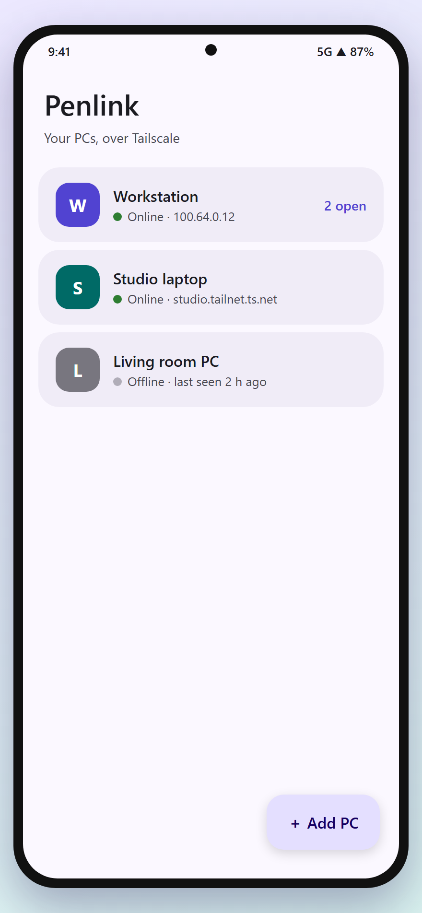
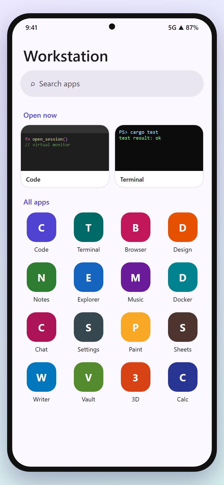
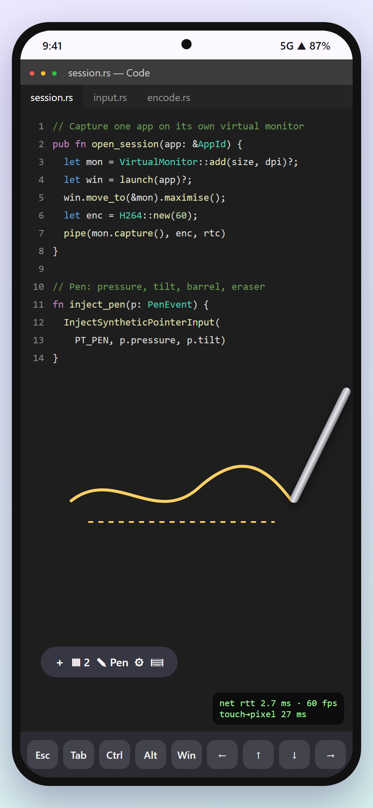
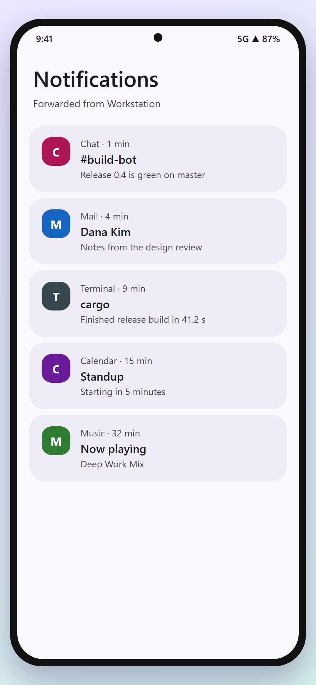

# Penlink

Run one Windows app full screen on your Android phone, with or without the S Pen.

Penlink is not a remote desktop. You pick an app on your PC, and only that app opens on the phone,
sized to the phone's screen. Each app gets its own virtual monitor on the PC, so menus, popups and
dialogs come along, and rotating the phone resizes the app. Built mainly for coding on the go, and it
works for general apps too.

<p align="center">
  
  
  
  
</p>

<sub>The images above are illustrations of the app's screens. Real captures from the end-to-end tests are in
[`docs/e2e/`](docs/e2e).</sub>

## Features

- **One app, not the desktop.** Tap an app from the PC's Start Menu or Store apps; it opens alone, full screen.
- **A virtual monitor per app** (SudoVDA driver, installed by the host on first run), sized to the phone's safe area.
  Falls back to plain window capture if the driver isn't there.
- **Pen, touch, mouse and keyboard.** S Pen pressure, tilt, barrel button and eraser go to Windows as real pen input.
  Palm rejection ignores your hand while the pen is near.
- **Several apps at once**, each its own session; minimise, switch and close from the phone.
- **Phone keyboard** with an extra-keys row (Esc, Tab, Ctrl, Alt, Win, arrows). The picture pans so the line you type
  on stays visible.
- **UI size slider** and a "Sharp text" mode, saved per PC.
- **PC notifications** forwarded to the phone, per app.
- **Low latency:** WebRTC with H.264, about 27 ms touch-to-pixel measured over a local connection. An optional stats overlay
  shows where the time goes.
- **Private by default:** the host only answers on loopback and Tailscale (LAN is opt-in), and the phone pairs with a
  one-time 6-digit code.

## How it works

```
Phone (Kotlin, Jetpack Compose)                 PC (Rust, penlink-host.exe)
  pick PC -> pick app  ── HTTP/WebSocket ──▶  launch app, add virtual monitor
  video view           ◀── WebRTC H.264 ───  capture monitor, encode (openh264)
  pen/touch/keys       ── data channel ───▶  SendInput / InjectSyntheticPointerInput
```

The full protocol and behaviour are described in [`SPEC.md`](SPEC.md).

## Getting started

You need a Windows 10/11 PC, an Android 13+ phone, and both on the same Tailscale network (or LAN).

1. **PC:** build and run the host (see [`host/README.md`](host/README.md)):
   ```bash
   cd host
   cargo build --release
   target/release/penlink-host.exe
   ```
   It prints a 6-digit pairing code. On first start it asks once (UAC) to install the virtual display driver.
2. **Phone:** build and install the app (see [`android/README.md`](android/README.md)):
   ```bash
   cd android
   ./gradlew assembleDebug
   adb install -r app/build/outputs/apk/debug/app-debug.apk
   ```
3. In the app tap **Add PC**, enter the PC's Tailscale address and the code, then tap an app.

## Repository layout

| Path       | What                                                        |
|------------|-------------------------------------------------------------|
| `host/`    | Windows agent in Rust: capture, encode, WebRTC, input, driver |
| `android/` | Phone app in Kotlin + Jetpack Compose (package `dev.penlink`) |
| `docs/`    | Screenshots and end-to-end test captures                    |
| `SPEC.md`  | Protocol and behaviour spec                                 |

## Status

Windows host and Android app work today. Hardware video encoding and a macOS host are planned.

## License

MIT, see [`LICENSE`](LICENSE). The host embeds the SudoVDA driver (MIT) and nefcon (BSD-3-Clause); see
[`THIRD-PARTY-NOTICES.md`](THIRD-PARTY-NOTICES.md).
